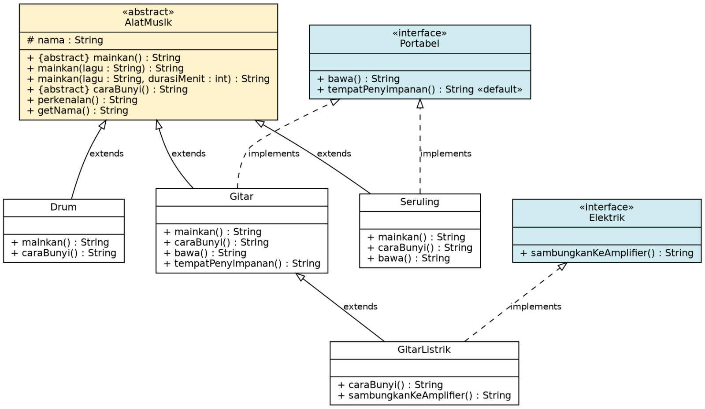

# Sistem Alat Musik
### Abstract Class, Interface, Inheritance & Polymorphism (Java)

**Mata Kuliah:** Pemrograman Berorientasi Objek  
**Kelas:** 3D  
**Anggota:** HENI PATUN PIDANI (F1D02510009) & LAILATUSSADIYAH (F1D02510012)

## 1. Studi Kasus
Sebuah grup musik memiliki beberapa alat musik: **Gitar Akustik, Gitar Listrik, Drum, dan Seruling**.
Semuanya punya nama dan bisa diperkenalkan, tetapi **cara dimainkan dan cara menghasilkan bunyinya berbeda**.
Selain itu, sebagian alat **portabel** (mudah dibawa) dan sebagian **elektrik** (butuh amplifier).

## 2. Class Diagram


Notasi: garis tebal + segitiga kosong = `extends`; garis putus-putus + segitiga kosong = `implements`.

## 3. Struktur Proyek
```
src/musik/
├── AlatMusik.java    (abstract class)
├── Portabel.java     (interface + default method)
├── Elektrik.java     (interface)
├── Gitar.java        (extends AlatMusik, implements Portabel)
├── GitarListrik.java (extends Gitar, implements Elektrik)
├── Drum.java         (extends AlatMusik)
├── Seruling.java     (extends AlatMusik, implements Portabel)
└── Main.java
docs/ (class_diagram.png, output.txt)
```

## 4. Penjelasan Konsep

| Konsep | Lokasi | Penjelasan |
|---|---|---|
| **Abstract class** | `AlatMusik` | Tidak bisa di-`new`. Berisi atribut `nama`, method konkret `perkenalan()`, dan abstract method. |
| **Abstract method** | `mainkan()`, `caraBunyi()` | Hanya deklarasi; tiap alat musik wajib mengisi sendiri. |
| **Inheritance** | `Gitar`, `Drum`, `Seruling` `extends AlatMusik` | Mewarisi `nama`, `perkenalan()`, `getNama()`. `super("...")` memanggil constructor parent. |
| **Inheritance berlapis** | `GitarListrik` → `Gitar` → `AlatMusik` | Gitar Listrik mewarisi semua milik Gitar, lalu meng-override `caraBunyi()`. |
| **Interface** | `Portabel`, `Elektrik` | Kemampuan opsional (*can-do*) yang hanya dimiliki sebagian alat musik. |
| **Default method** | `Portabel.tempatPenyimpanan()` | Bawaan "tas biasa"; `Seruling` memakainya, `Gitar` meng-override jadi "gig bag". |
| **Overriding** | `mainkan()`, `caraBunyi()` di `Gitar`, `Drum`, `Seruling`; `caraBunyi()` di `GitarListrik`; `tempatPenyimpanan()` di `Gitar` | Subclass menulis ulang method parent/interface dengan **signature yang sama** (`@Override`). Versi yang dipakai ditentukan saat **runtime** sesuai objek. |
| **Overloading** | `AlatMusik.mainkan()`, `mainkan(String)`, `mainkan(String, int)` | Nama method sama, **parameter berbeda**. Versi yang dipakai ditentukan saat **kompilasi** dari argumen yang diberikan. |
| **Polymorphism (runtime)** | `Main` | `List<AlatMusik>` berisi berbagai objek. `a.mainkan()` dan `a.perkenalan()` menghasilkan perilaku sesuai objek aslinya. `perkenalan()` milik parent memanggil `caraBunyi()` versi subclass. |
| **Polymorphism via interface** | `Main` | `a instanceof Portabel p` / `instanceof Elektrik e` memilah objek berdasarkan kemampuan. |
| **Encapsulation** | atribut `protected` | Atribut `nama` hanya dapat diakses class itu sendiri dan turunannya. |

### Overriding vs Overloading

| | Overriding | Overloading |
|---|---|---|
| Lokasi | Class berbeda (parent dan child) | Biasanya satu class yang sama |
| Signature | Sama persis | Parameter harus berbeda |
| Dipilih saat | Runtime (*dynamic binding*) | Kompilasi (*static binding*) |
| Contoh | `Drum.mainkan()` menggantikan `AlatMusik.mainkan()` | `mainkan()`, `mainkan(lagu)`, `mainkan(lagu, durasi)` |

## 5. Mengapa Abstract Class dan Interface Dipisah?
- `AlatMusik` = **abstract class**: semua alat musik *adalah* alat musik (*is-a*) dan punya data/perilaku bersama.
- `Portabel` & `Elektrik` = **interface**: ini kemampuan (*can-do*) yang tidak dimiliki semua alat. Drum tidak portabel,
  Gitar Akustik tidak elektrik. Jika dimasukkan ke `AlatMusik`, semua subclass terpaksa memilikinya.

## 6. Cara Menjalankan
```bash
javac -d out src/musik/*.java
java -cp out musik.Main
```
Contoh output ada di `docs/output.txt`.

## 7. Pembagian Tugas
- HENI: README, abstract class, subclass, class diagram
- LAILA: interface, Main, , pengujian, AlatMusik
